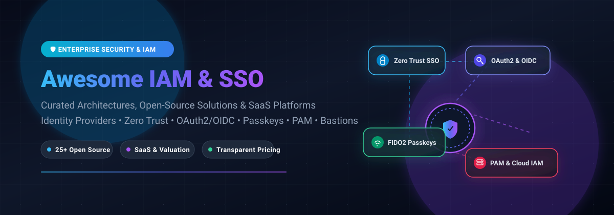

# Awesome Identity & Access Management (IAM) & SSO 🔐

  

  
  
  
  
  
  
  

> 🌟 **A curated list of top Identity & Access Management (IAM), Single Sign-On (SSO), Customer Identity & Access Management (CIAM), Multi-Factor Authentication (MFA), OAuth2/OIDC servers, Passkeys/FIDO2, and Privileged Access Management (PAM) architectures.** Features enterprise SaaS leaders alongside vetted open-source alternatives.

---

## 📑 Table of Contents
- [🌐 Sector Overview & Market Dynamics](#-sector-overview--market-dynamics)
- [🏢 SaaS & Hosted Enterprise Platforms](#-saas--hosted-enterprise-platforms)
- [🔓 Open-Source Equivalents & Tools](#-open-source-equivalents--tools)
  - [🛡️ Full-Featured Enterprise IAM & SSO Identity Providers](#️-full-featured-enterprise-iam--sso-identity-providers)
  - [⚡ Modern Lightweight Self-Hosted SSO & Reverse-Proxy Auth](#-modern-lightweight-self-hosted-sso--reverse-proxy-auth)
  - [💻 Developer-First CIAM, OAuth2 & OIDC Servers](#-developer-first-ciam-oauth2--oidc-servers)
  - [🔑 Multi-Factor Authentication (MFA) & Passkey/WebAuthn Tools](#-multi-factor-authentication-mfa--passkeywebauthn-tools)
  - [🏰 Privileged Access Management (PAM) & Identity Governance (IGA)](#-privileged-access-management-pam--identity-governance-iga)
  - [📂 Directory Services & LDAP / Active Directory Alternatives](#-directory-services--ldap--active-directory-alternatives)
- [📈 Star History](#-star-history)
- [🤝 Contributing](#-contributing)
- [💖 Support & Sponsorship](#-support--sponsorship)

---

## 🌐 Sector Overview & Market Dynamics

The global **Identity and Access Management (IAM)** market is estimated at **$21 billion to $27 billion** (expanding at an annualized CAGR of **11%–15%** towards $45B+). The sector exhibits a **moderately concentrated, top-heavy structure** where hyperscalers and specialized cybersecurity giants (such as Microsoft, Okta, CyberArk, and Cisco) capture the majority of high-contract enterprise workforce and PAM budgets, yet it remains **dynamically fragmented across emerging sub-segments**—particularly developer-first CIAM, passwordless/Passkey infrastructure, zero-trust reverse proxies, and Kubernetes-native authorization engines where nimble open-source solutions frequently win out.

---

## 🏢 SaaS & Hosted Enterprise Platforms

Commercial, cloud-hosted enterprise identity providers, managed CIAM APIs, cloud directory services, and proprietary PAM/MFA suites, sorted descending by company size (valuation / annual revenue).

| Platform | Description | Size (Valuation / Revenue) | Starting Tier Pricing | Free Tier / Free Trial Limits |
| :--- | :--- | :--- | :--- | :--- |
| **[Microsoft Entra ID](https://microsoft.com)** | Enterprise cloud identity and access management service tightly integrated with Microsoft 365, Azure, and Conditional Access policies. | **$3.1T+ Valuation** ($245B+ Annual Revenue) | **$7.00 / user / month** (Entra ID P1; billed annually) | **Permanent Free Tier** (bundled with Microsoft Azure/365 cloud subscriptions; includes basic SSO & Security Defaults MFA; External ID free up to 50,000 MAU) |
| **[Cisco Duo Security](https://duo.com)** | Cloud-based zero-trust access security and Multi-Factor Authentication (MFA) provider verifying user identity and device health. | **$235B+ Valuation** ($53.8B+ Annual Revenue) | **$3.00 / user / month** (Duo Essentials; billed annually) | **Permanent Free Tier** (up to 10 users max; includes basic MFA & Duo Mobile app) / 30-day full-feature free trial |
| **[CyberArk](https://cyberark.com)** | Industry-standard proprietary Privileged Access Management (PAM) and identity security platform protecting high-privilege credentials and sessions. | **$15B+ Valuation** ($1.0B+ Annual Revenue) | **~$3,726 / month** ($44,712/year minimum for Privilege Cloud starter bundle of 25 users, ~$1,788/user/yr) | **No Permanent Free Tier** (14 to 30-day guided enterprise Proof of Concept / trial via sales request, scoped to evaluation environment) |
| **[Okta](https://okta.com)** | Market-leading cloud Identity-as-a-Service (IDaaS) platform providing workforce SSO, universal directory, lifecycle management, and adaptive MFA. | **$15B+ Valuation** ($2.6B+ Annual Revenue) | **$6.00 / user / month** (Starter Suite; billed annually, $1,500 annual minimum spend floor) | **No Permanent Workforce Free Tier** (Developer integrator plan free up to 10 active users; Workforce platform offers a 30-day free trial limited to 10 users, 1 admin, and 5 workflows) |
| **[Auth0 (by Okta)](https://auth0.com)** | Developer-centric managed authentication and authorization platform for rapid B2C, B2B, and SaaS CIAM integration. | **$6.5B Valuation** (Acquired by Okta; part of Okta's $2.6B+ ARR) | **$35.00 / month** (B2C Essentials, 500 MAU tier) / **$150.00 / month** (B2B Essentials, 500 MAU tier) | **Permanent Free Tier** (up to 25,000 Monthly Active Users (MAUs), 5 organizations, 1 enterprise SAML/OIDC connection, unlimited social connections) |
| **[Ping Identity](https://pingidentity.com)** | Enterprise hybrid and cloud identity security platform supporting complex federation, OAuth/OIDC, SAML, and zero-trust access. | **$2.8B Valuation** (Acquired by Thoma Bravo; combined Ping/ForgeRock ARR ~$1B) | **$3.00 / user / month** (PingOne Workforce Essential; typically 5,000 user contract minimum) | **No Permanent Free Tier** (30-day free trial via PingOne, limited to 5 environments and up to 1,000 active test identities) |
| **[JumpCloud](https://jumpcloud.com)** | Open cloud directory platform unifying device management (MDM), RADIUS, LDAP, SAML SSO, and multi-OS user authentication. | **$2.6B Valuation** (~$200M Annual Recurring Revenue) | **$9.00 / user / month** (Device Management; billed annually) / **$11.00 / user / month** (SSO Plan) | **No Permanent Free Tier for New Accounts** (30-day unrestricted free trial with full platform access; legacy free tier up to 10 users/devices grandfathered pre-Feb 2024) |
| **[ForgeRock (Ping Identity)](https://forgerock.com)** | Enterprise digital identity platform for large-scale workforce, consumer, and IoT identity orchestration. | **$2.3B Valuation** (Acquired by Thoma Bravo; integrated into Ping Identity) | **~$2,916 / month** (~$35,000/year enterprise base package minimum) | **No Permanent Free Tier** (30-day Proof of Concept / sandbox evaluation trial via sales engagement) |
| **[OneLogin](https://onelogin.com)** | Cloud-based unified access management platform offering enterprise SSO, smart-factor authentication, and automated user provisioning. | **$500M Valuation** (Acquired by One Identity/Quest; parent valuation $5.4B) | **$2.00 / user / month** (Starter plan; billed annually) | **No Permanent Free Tier** (30-day free trial, no credit card required, includes core SSO, MFA, and cloud directory) |
| **[SecureAuth](https://secureauth.com)** | Commercial adaptive authentication and passwordless CIAM/workforce identity platform with behavioral risk scoring. | **$225M Valuation** (~$44M - $95M Annual Revenue) | **$1.00 / user / month** (Baseline entry tier index; sales-quoted annual contract) | **No Permanent Free Tier** (14 to 30-day production-ready tenant free trial / POC without credit card) |

---

## 🔓 Open-Source Equivalents & Tools

Free and open-source software (FOSS) identity providers, self-hosted SSO portals, OAuth2/OIDC engines, passwordless authentication servers, and PAM/IGA suites. Repositories in each category are ranked and sorted in descending order by GitHub star count.

### 🛡️ Full-Featured Enterprise IAM & SSO Identity Providers

* **[Keycloak](https://github.com/keycloak/keycloak)**  - CNCF-incubating open-source Identity and Access Management solution for modern applications and services supporting OIDC, OAuth 2.0, SAML 2.0, and social login.
* **[authentik](https://github.com/goauthentik/authentik)**  - Open-source, modern Identity Provider emphasizing flexibility and versatility with SAML, OAuth2/OIDC, LDAP, SCIM, and forward-auth proxy support.
* **[ZITADEL](https://github.com/zitadel/zitadel)**  - Cloud-native, open-source identity infrastructure written in Go featuring event-sourced audit trails, multi-tenancy, B2B delegation, and passkeys.
* **[Casdoor](https://github.com/casbin/casdoor)**  - UI-first open-source Identity and Access Management (IAM) / Single-Sign-On (SSO) platform built on Casbin supporting OAuth 2.0, OIDC, SAML, and CAS.
* **[Apereo CAS](https://github.com/apereo/cas)**  - Enterprise multilingual Single Sign-On solution supporting CAS protocol, SAML, OAuth 2.0, OpenID Connect, and multifactor authentication.
* **[WSO2 Identity Server](https://github.com/wso2/product-is)**  - Extensible, API-driven enterprise open-source IAM and CIAM server supporting federation, adaptive auth, and compliance.
* **[Gluu Server / Janssen Project](https://github.com/JanssenProject/jans)**  - Linux Foundation open-source cloud-native identity and access management platform built for high-scale OAuth, OIDC, and FIDO2.

### ⚡ Modern Lightweight Self-Hosted SSO & Reverse-Proxy Auth

* **[Authelia](https://github.com/authelia/authelia)**  - Open-source authentication and authorization server providing 2FA and SSO for self-hosted applications via reverse proxies (Traefik, Nginx, Caddy).
* **[OAuth2 Proxy](https://github.com/oauth2-proxy/oauth2-proxy)**  - Reverse proxy and static file server providing authentication using providers like Google, GitHub, Keycloak, and OIDC.
* **[Pocket ID](https://github.com/pocket-id/pocket-id)**  - Simple, lightweight open-source OIDC provider engineered exclusively around passwordless Passkeys/WebAuthn authentication.
* **[Tinyauth](https://github.com/steveiliop56/tinyauth)**  - Minimalist, ultra-lightweight authentication middleware protecting Docker and reverse-proxy apps with simple login screens or OAuth.
* **[Pomerium](https://github.com/pomerium/pomerium)**  - Open-source identity-aware access proxy enforcing zero-trust, context-aware access policies without requiring a corporate VPN.

### 💻 Developer-First CIAM, OAuth2 & OIDC Servers

* **[Ory Hydra](https://github.com/ory/hydra)**  - Certified, hardened OAuth 2.0 and OpenID Connect (OIDC) server built on Go for scalable enterprise authorization.
* **[SuperTokens](https://github.com/supertokens/supertokens-core)**  - Open-source user authentication solution providing session management, social login, passwordless, and multi-tenant B2B flows.
* **[Logto](https://github.com/logto-io/logto)**  - Modern open-source alternative to Auth0 offering passwordless sign-in, RBAC, multi-tenancy organizations, and SDKs for web and mobile apps.
* **[Ory Kratos](https://github.com/ory/kratos)**  - Certified, API-first, cloud-native headless user management and authentication system.
* **[Dex](https://github.com/dexidp/dex)**  - Federated OpenID Connect provider acting as a portal to external identity sources (LDAP, SAML, GitHub, GitLab) for Kubernetes and cloud apps.
* **[Hanko](https://github.com/teamhanko/hanko)**  - Open-source authentication and user management solution built around FIDO2/WebAuthn passkeys and modern frontend web components.
* **[Kanidm](https://github.com/kanidm/kanidm)**  - Modern, simple, and ultra-secure identity management platform written in Rust with native Passkeys, OAuth2, LDAP, and POSIX/SSH integration.
* **[Ory Keto](https://github.com/ory/keto)**  - Open-source implementation of Google Zanzibar cryptographic access control and permission management server.
* **[Cerbos](https://github.com/cerbos/cerbos)**  - Cloud-native, open-source authorization layer for context-aware role-based (RBAC) and attribute-based (ABAC) access control.

### 🔑 Multi-Factor Authentication (MFA) & Passkey/WebAuthn Tools

* **[2FAuth](https://github.com/Bubka/2FAuth)**  - Self-hosted open-source web app for managing Two-Factor Authentication (TOTP/HOTP) accounts and generating security codes across devices.
* **[privacyIDEA](https://github.com/privacyidea/privacyidea)**  - Modular, open-source multi-factor authentication server supporting OTP tokens, FIDO2/WebAuthn, push notifications, and RADIUS/PAM.
* **[LinOTP](https://github.com/LinOTP/LinOTP)**  - Flexible open-source enterprise solution for two-factor authentication with one-time passwords and hardware tokens.

### 🏰 Privileged Access Management (PAM) & Identity Governance (IGA)

* **[JumpServer](https://github.com/jumpserver/jumpserver)**  - Popular open-source Privileged Access Management (PAM) bastion host supporting SSH, RDP, Kubernetes, and database session auditing.
* **[Teleport](https://github.com/gravitational/teleport)**  - Open-source identity-native infrastructure access plane replacing SSH keys, VPNs, and static credentials with short-lived certificates.
* **[MidPoint (Evolveum)](https://github.com/Evolveum/midpoint)**  - Comprehensive open-source Identity Governance and Administration (IGA) platform for lifecycle workflows, RBAC, and compliance.
* **[Apache Syncope](https://github.com/apache/syncope)**  - Open-source enterprise system for managing digital identities, provisioning, reconciliation, and Identity Governance (IGA).

### 📂 Directory Services & LDAP / Active Directory Alternatives

* **[LLDAP (Light LDAP)](https://github.com/lldap/lldap)**  - Opinionated, lightweight open-source LDAP implementation designed specifically for easy user management and self-hosted authentication.
* **[FreeIPA](https://github.com/freeipa/freeipa)**  - Integrated open-source security information management solution combining Linux, 389 Directory Server, Kerberos, DNS, and CA.
* **[Samba Active Directory](https://github.com/samba-team/samba)**  - Open-source software suite providing full Active Directory Domain Controller compatibility, Kerberos, LDAP, and SMB/CIFS services.

---

## 📈 Star History

---

## 🤝 Contributing

Contributions are always welcome! Feel free to open a Pull Request to add more open-source IAM platforms, OIDC/OAuth2 providers, PAM bastion hosts, or directory services.

1. 🍴 Fork the repository.
2. 🌿 Create a feature branch: `git checkout -b feature/new-iam-platform`.
3. 📝 Add your project under the appropriate category with its repository link, star badge, and a concise description.
4. 🚀 Submit a Pull Request.

---

## 💖 Support & Sponsorship

If you find this curated collection helpful for your engineering, DevOps, or enterprise security architecture, please consider supporting the project:

- ⭐ **Star this repository** to help others discover it!
- 🍴 **Fork and share** with colleagues and security teams.
- ☕ **Buy a coffee & sponsor**: Support continued curation and open-source maintenance via the [GitHub Sponsor Dashboard](https://github.com/sponsors/ishandutta2007).
